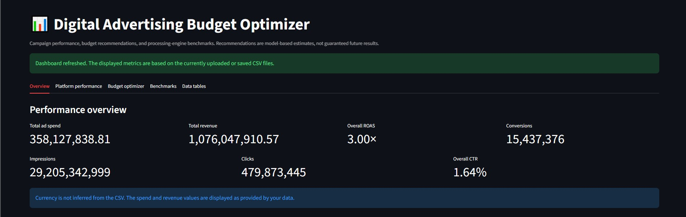
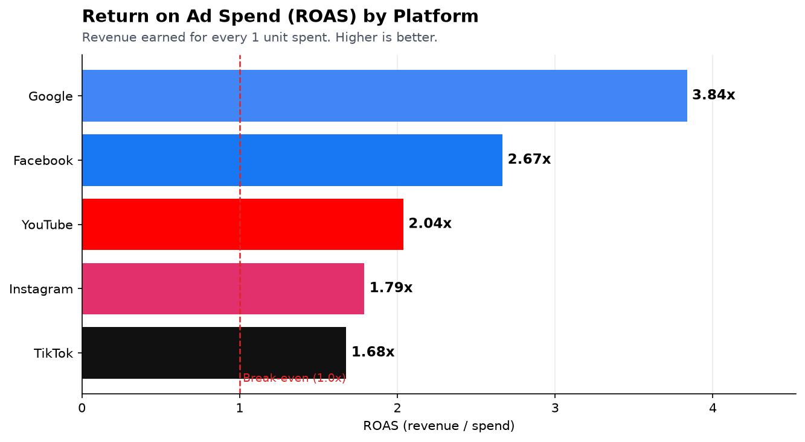
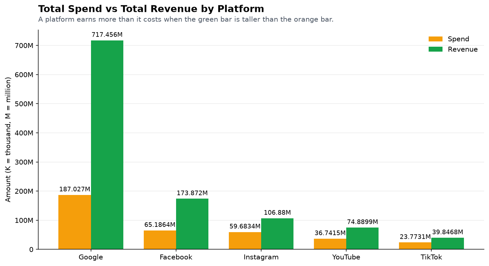
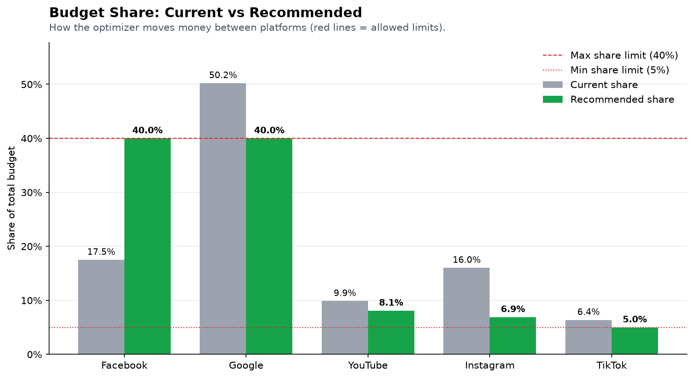
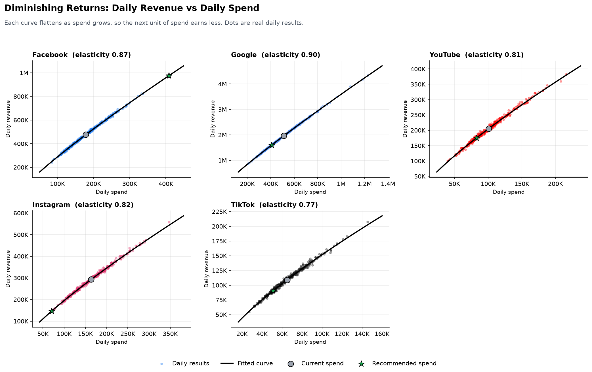
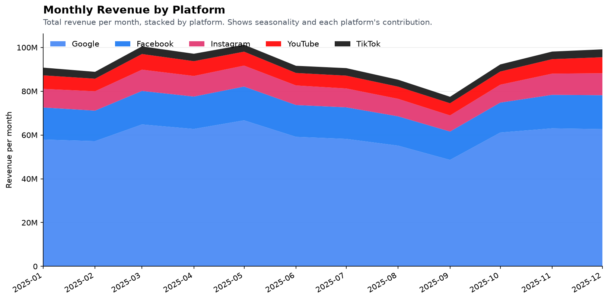
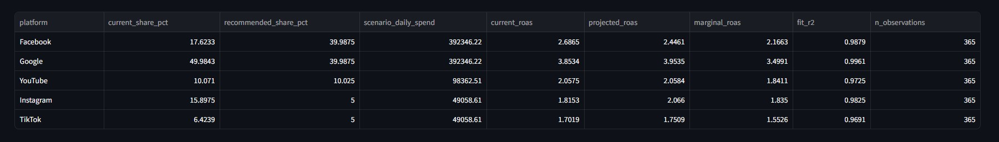

# 📊 Digital Advertising Budget Optimizer
> **Answer the management question:** *"Where should we spend the next Rs. 1 million?"*   
> A big-data analytics pipeline that simulates digital marketing campaigns at scale (10K → 10M records), benchmarks three processing engines, calculates marketing KPIs, and recommends an optimal advertising budget split across platforms. 

---

## 📸 Dashboard Preview 



--- 

## 📋 Table of Contents

- [Features](#-features)
- [Project Structure](#-project-structure)
- [Tech Stack](#-tech-stack)
- [Setup](#-setup)
- [Running the Project](#-running-the-project)
- [Charts & Visualizations](#-charts--visualizations) 
- [Platform KPI Results](#-platform-kpi-results-10m-records)
- [Budget Recommendation](#-budget-recommendation-10m-records)
- [Benchmark Results](#-benchmark-results)
- [Architecture](#-architecture)
- [Testing](#-testing)
- [Limitations](#-limitations)
- [Future Improvements](#-future-improvements) 

---

## ✨ Features

| Feature | Description |
|---|---|
| **Scalable data generation** | Reproducible synthetic campaigns from 10K to 10M records, written in chunks with platform, campaign, audience, device, age, gender and city fields |
| **Marketing KPI analytics** | CTR, CPC, CPA, Conversion Rate, ROAS and CPM — calculated from aggregated totals, never row-level averages |
| **Processing-engine benchmarks** | Pandas, a multiprocessing MapReduce simulation, and PySpark — each in an isolated subprocess |
| **Runtime & memory measurement** | Processing time, engine start-up time, and peak memory including child processes (PSS-based, no double-counting) |
| **Cross-engine correctness checks** | Every engine's output is compared with the Pandas reference (groups, row counts and totals) |
| **Budget optimization** | Diminishing-returns power-law response curves, solved exactly under per-platform share limits via bisection |
| **Risk flags** | Warnings for extrapolation, clipped elasticity, weak curve fits and limit-breaking allocations |
| **Auto-generated charts** | 5–6 labelled PNG charts saved to `charts/` on every pipeline run |
| **Interactive Streamlit dashboard** | Live KPI results, budget recommendations, and benchmark outputs |
| **Automated tests & CI** | Unit, integration and dashboard tests covering all major modules |

---

## 🗂 Project Structure

```text
Digital-Advertising-Budget-Optimizer/
├── app.py                    # Streamlit dashboard
├── main.py                   # End-to-end pipeline
├── data_generator.py         # Synthetic campaign data generator
├── metrics_calculator.py     # KPI calculation and validation
├── processing_engines.py     # Pandas, MapReduce and PySpark engines
├── benchmark_analysis.py     # Benchmark runner (time, memory, consistency)
├── budget_optimizer.py       # Response curves and allocation solver
├── charts.py                 # Chart generation (saved to charts/)
├── requirements.txt
├── pytest.ini
├── tests/                    # Automated test suite (72 tests)
├── data/                     # Generated datasets (git-ignored)
├── charts/                   # Generated PNG charts (git-ignored)
├── docs/                     # Static images committed for README rendering
│   └── charts/
├── results/
│   ├── kpis_by_platform.csv
│   ├── benchmark_results.csv
│   ├── budget_recommendation.csv
│   └── budget_summary.csv
└── assets/
    ├── budget-optimizer.jpg
    └── UI-of-ad-budget-optimizer.jpg
```

---

## 🛠 Tech Stack

| Layer | Technology |
|---|---|
| Core language | Python 3.10+ |
| Data processing | Pandas / NumPy |
| Distributed processing | PySpark (local mode) |
| Memory measurement | psutil (PSS-based process tree) |
| Visualization | Matplotlib (charts), Plotly (dashboard) |
| Dashboard | Streamlit |
| Testing | pytest |

---

## ⚙️ Setup

**Requirements:**
- Python 3.10 or newer
- Java 17 or newer (for PySpark; optional — benchmark skips it gracefully if unavailable)

**Install dependencies (using uv — recommended):**

```bash
uv venv --python 3.12
uv pip install -r requirements.txt
```

**Or with pip:**

```bash
pip install -r requirements.txt
```

> PySpark may print a warning about pandas 3 compatibility. Results in this README were produced with pandas 3.x and PySpark 4.3.0 and passed every consistency check. Use pandas 2.x if you encounter issues.

---

## 🚀 Running the Project

### Standard pipeline (10K, 100K, 1M records)

```bash
python main.py
```

### Full pipeline including 10M records

```bash
python main.py --full
```

### Skip benchmark (fastest, KPIs + budget only)

```bash
python main.py --skip-benchmark
```

### Select specific engines and trial count

```bash
python main.py --engines pandas mapreduce --trials 3
```

### Customize budget and share limits

```bash
python main.py --campaign-budget 1000000 --currency "Rs." --min-share 0.10 --max-share 0.35
```

> `--budget` sets the **daily** budget used by the optimizer (defaults to historical daily spend).  
> `--campaign-budget` is the total amount split across platforms in the output.

### Run individual modules

```bash
python data_generator.py --records 1000000
python benchmark_analysis.py --scales 100000 --engines pandas mapreduce pyspark
```

### Launch the interactive dashboard

```bash
streamlit run app.py
```

The dashboard reads CSVs from `results/`. Click **Update Dashboard** in the sidebar to reload; it does not re-run the analytics pipeline. Re-run `main.py` to regenerate results.

---

## 📈 Charts & Visualizations

All charts are auto-generated and saved to `charts/` on each pipeline run.

### ROAS by Platform
> Revenue earned per unit of spend — the primary efficiency signal.



---

### Spend vs Revenue by Platform
> Absolute scale comparison showing which platforms drive the most volume.



---

### Budget Share: Current vs Recommended
> Side-by-side view of today's allocation versus the optimizer's recommendation, with share limit bands.



---

### Diminishing-Returns Response Curves
> Power-law revenue response curves per platform, with current and recommended spend marked. The flatter the curve, the faster returns diminish.



---

### Monthly Revenue by Platform
> Stacked monthly revenue showing seasonal and weekly patterns in the simulated data.



---

## 📊 Platform KPI Results (10M records)

> Figures from the 10M-record simulation — the most statistically robust run.

| Platform | Impressions | Clicks | Spend | Conversions | Revenue | CTR | CPC | CPA | Conv. Rate | **ROAS** |
|---|---:|---:|---:|---:|---:|---:|---:|---:|---:|---:|
| **Google** | 8.40B | 252.8M | Rs.187.0M | 9.76M | Rs.717.5M | 3.01% | Rs.0.74 | Rs.19.17 | 3.86% | **3.84×** |
| Facebook | 7.56B | 90.9M | Rs.65.2M | 2.78M | Rs.173.9M | 1.20% | Rs.0.72 | Rs.23.41 | 3.06% | 2.67× |
| YouTube | 4.02B | 32.3M | Rs.36.7M | 1.02M | Rs.74.9M | 0.80% | Rs.1.14 | Rs.36.06 | 3.15% | 2.04× |
| Instagram | 6.01B | 60.3M | Rs.59.7M | 1.54M | Rs.106.9M | 1.00% | Rs.0.99 | Rs.38.81 | 2.55% | 1.79× |
| TikTok | 4.31B | 62.7M | Rs.23.8M | 0.86M | Rs.39.8M | 1.45% | Rs.0.38 | Rs.27.65 | 1.37% | 1.68× |
| **Overall** | **30.3B** | **499.0M** | **Rs.372.4M** | **15.96M** | **Rs.1,112.9M** | 1.65% | Rs.0.75 | Rs.23.34 | 3.20% | **2.99×** |

**Key takeaways:**
- **Google** dominates on ROAS (3.84×) and conversion rate (3.86%) — highest-quality traffic.
- **TikTok** has the cheapest CPC (Rs.0.38) but lowest ROAS (1.68×) and conversion rate — volume without quality.
- **Facebook** is under-allocated relative to its elasticity — the optimizer moves the most budget here.
- **Instagram** has the highest CPA (Rs.38.81) — currently over-funded relative to its marginal return.

---

## 💡 Budget Recommendation (10M records)

> Based on power-law response curves fitted to historical daily spend/revenue, with share limits of 5%–40% per platform.

)

### Recommended split of Rs. 1,000,000

| Platform | Current Share | Recommended Share | Change | Marginal ROAS | Elasticity | Curve Fit R² | Amount |
|---|---:|---:|---:|---:|---:|---:|---:|
| **Facebook** | 17.5% | **40.0%** ↑ | +22.5pp | 2.07× | 0.87 | 1.00 | Rs. 400,000 |
| **Google** | 50.2% | **40.0%** ↓ | −10.2pp | 3.54× | 0.90 | 1.00 | Rs. 400,000 |
| YouTube | 9.9% | 8.1% ↓ | −1.8pp | 1.71× | 0.81 | 0.99 | Rs. 80,950 |
| Instagram | 16.0% | 6.9% ↓ | −9.1pp | 1.71× | 0.82 | 1.00 | Rs. 69,050 |
| TikTok | 6.4% | 5.0% ↓ | −1.4pp | 1.36× | 0.77 | 0.99 | Rs. 50,000 |

### Projected impact

| Metric | Value |
|---|---|
| Revenue/day — current allocation | Rs. 3,049,165 |
| Revenue/day — limit-compliant baseline | Rs. 2,866,871 |
| Revenue/day — recommended allocation | Rs. 2,987,783 |
| Uplift vs limit-compliant baseline | **+4.22%** |
| Uplift vs current | −2.01%* |
| Modeled ROAS change | 2.988× → 2.928× |

> \* Google currently exceeds the 40% cap. Enforcing the cap alone costs revenue, which is why uplift vs current is negative. Uplift vs the limit-compliant baseline (+4.22%) is the fair comparison. Raise `--max-share` if the cap is not a business requirement.

> ⚠️ **Note:** Facebook's recommended spend lies above its observed daily range — treat that projection as extrapolation.

---

## ⏱ Benchmark Results

Measured on a 1 vCPU / 4 GB Linux machine with Python 3.12.3, pandas 3.0.2, PySpark 4.3.0 and Java 21, using the median of 3 trials. Processing times exclude PySpark session start-up (~11s, reported separately in `benchmark_results.csv`).

| Records | Pandas | MapReduce | PySpark | Peak Memory: Pandas / MapReduce / Spark |
|---:|---:|---:|---:|---:|
| 10K | 0.03 s | 0.54 s | 8.33 s | 86 / 145 / 499 MB |
| 100K | 0.13 s | 0.57 s | 9.19 s | 96 / 168 / 526 MB |
| 1M | 1.23 s | 1.87 s | 11.33 s | 217 / 284 / 524 MB |
| 10M | 12.04 s | 12.58 s | 29.32 s | 1,310 / 331 / 560 MB |

> Re-run `python main.py --full` on your hardware to get environment-specific figures.

### Key observations

- **Pandas is fastest at every tested scale** on a single core — low start-up cost dominates up to 1M records; at 10M it is only ~4% faster than MapReduce.
- **Memory scales very differently:** Pandas peaks at ~1.3 GB at 10M records, while MapReduce (bounded byte splits) stays near 330 MB.
- **PySpark carries a large fixed cost** — session start-up plus job scheduling, unrecoverable on one core at these sizes. Memory is roughly constant due to JVM overhead.
- **MapReduce needs multiple cores** to pay off — on one core it adds process overhead without parallel speedup.

---

## 🏗 Architecture

```
              data_generator.py
                      │
                      ▼
             Campaign CSV datasets
                      │
          ┌───────────┼───────────┐
          │           │           │
          ▼           ▼           ▼
     KPI Analysis  Benchmark   Budget Optimizer
                   Analysis         │
          │           │             │
          ▼           ▼             ▼
     Platform KPIs  Runtime &   Response Curves
                    Memory          │
          │           │             │
          └───────────┴─────────────┘
                      │
                      ▼
                    main.py
                      │
                      ▼
             Results in CSV files
                      │
                      ▼
                 Streamlit UI
```

### Data Generation

The generator simulates campaigns across Facebook, Google, YouTube, Instagram and TikTok. Each platform has its own CPM, CTR, conversion rate, AOV, volume weight and **saturation exponent**.

Demand is modelled per day and platform with:
- **Weekday effects** — weaker weekends
- **Seasonality** — Q4 (Oct–Dec) peak
- **Shared daily shock** — correlated volatility
- **Saturation** — conversion efficiency falls as demand rises (diminishing returns baked in)

A fixed random seed makes generation fully reproducible. Datasets are cached with a metadata file; a mismatch triggers regeneration.

### KPI Calculation

KPIs are calculated from **aggregated totals** — not by averaging row-level ratios — to avoid Simpson's paradox.

| KPI | Formula |
|---|---|
| CTR | Clicks / Impressions × 100 |
| CPC | Spend / Clicks |
| CPA | Spend / Conversions |
| Conversion Rate | Conversions / Clicks × 100 |
| ROAS | Revenue / Spend |
| CPM | Spend / Impressions × 1,000 |

### Benchmark Methodology

Each engine performs the same aggregation task: group by platform and campaign, sum rows / impressions / clicks / spend / conversions / revenue.

| Engine | Method |
|---|---|
| **Pandas** | Reads only needed columns with explicit dtypes, aggregates with `groupby` |
| **MapReduce** | Splits file into line-aligned byte ranges; workers map/combine locally, partition by CRC32 hash, reducers reduce partials. Mappers use vectorised `read_csv` |
| **PySpark** | Local mode with an explicit schema built from the CSV header, `groupBy().agg()` |

Each engine runs in a **fresh subprocess** for the requested number of trials. Peak memory is measured with PSS (proportional set size) every 20ms so shared worker memory is never double-counted.

### Budget Optimization

A power-law response curve is fitted per platform by log-log regression:

```
Revenue = a × Spend ^ b
```

`b` is the spend elasticity — lower means faster diminishing returns. The slope is clipped to [0.05, 0.98] so every curve stays concave. Because all curves are concave, the optimal split is found **exactly** via bisection on the marginal-revenue level, then an exact budget correction.

---

## 🧪 Testing

```bash
python -m pytest -q
```

The suite (72 tests) covers:

- **Data generation** — reproducibility, funnel invariants (clicks ≤ impressions, conversions ≤ clicks), weekday and Q4 effects
- **KPI formulas** — correctness and edge cases (zero denominators, negative values)
- **Budget optimizer** — constraint satisfaction, optimality verified against thousands of random allocations, risk flags
- **Engine agreement** — all engines produce identical aggregated results
- **Benchmark behaviour** — skipped/failed engines, memory measurement
- **CLI pipeline** — end-to-end `main.py` integration test
- **Dashboard rendering** — Streamlit app loads without errors

> PySpark tests are skipped automatically when Java or PySpark is unavailable.

---

## ⚠️ Limitations

- **Synthetic data** — simulated campaigns do not capture real-world attribution, creative quality, audience overlap or platform reporting differences.
- **Simplified response curves** — spend is the only revenue driver; cross-platform interactions are not modelled.
- **Extrapolation risk** — recommendations are unreliable when projected spend falls far outside the observed range (flagged automatically).
- **Small-sample noise** — at 10K records each platform has few rows per day, so row-count noise dominates daily totals and curve fits are weaker (flagged when R² < 0.80).
- **Single-core benchmarks** — one-core results do not represent a multi-core workstation or Hadoop cluster.
- **Memory sampling granularity** — peak memory sampled every 20ms; very short runs may miss brief spikes.
- **No causal validation** — a good fit on synthetic data does not establish predictive accuracy on real campaigns.

---

## 🔭 Future Improvements

- Validate recommendations against held-out campaign data or controlled A/B experiments.
- Add confidence intervals and sensitivity analysis for budget allocations.
- Compare serial vs parallel processing on machines with different core counts.
- Support exporting reports directly from the dashboard (PDF / Excel).
- Evaluate the optimizer on real, appropriately attributed campaign data before using it for business decisions.
- Add support for custom response curve models (e.g., S-curve / logistic) for platforms with long ramp-up periods.

---

> **Note:** Benchmark, KPI and budget tables reflect a specific run. Re-run the pipeline and update these figures whenever code, data-generation settings, dependencies or the benchmark environment change.
